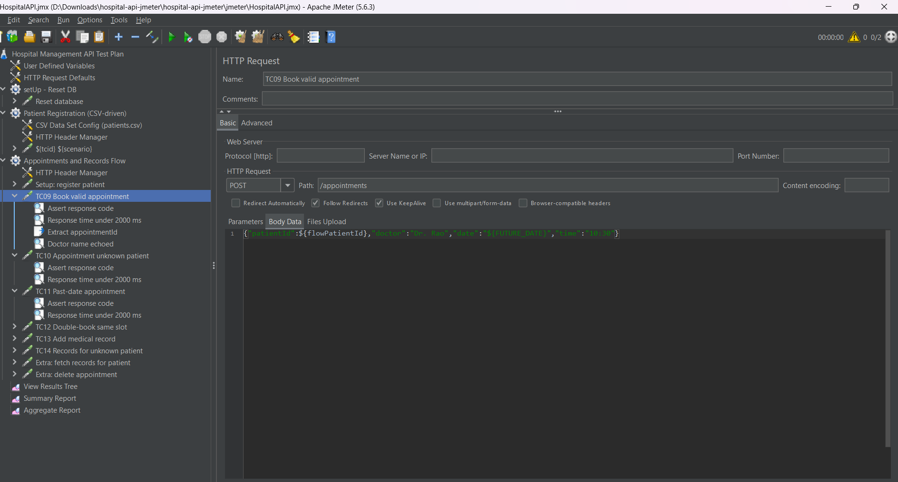
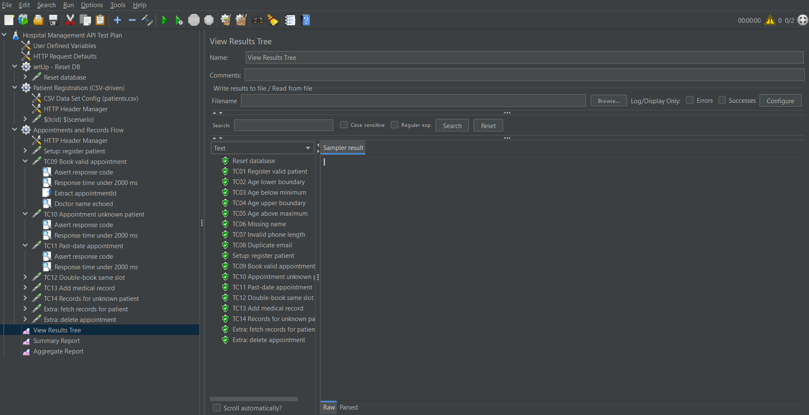
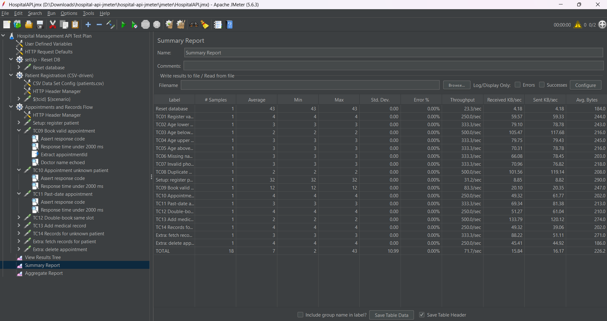
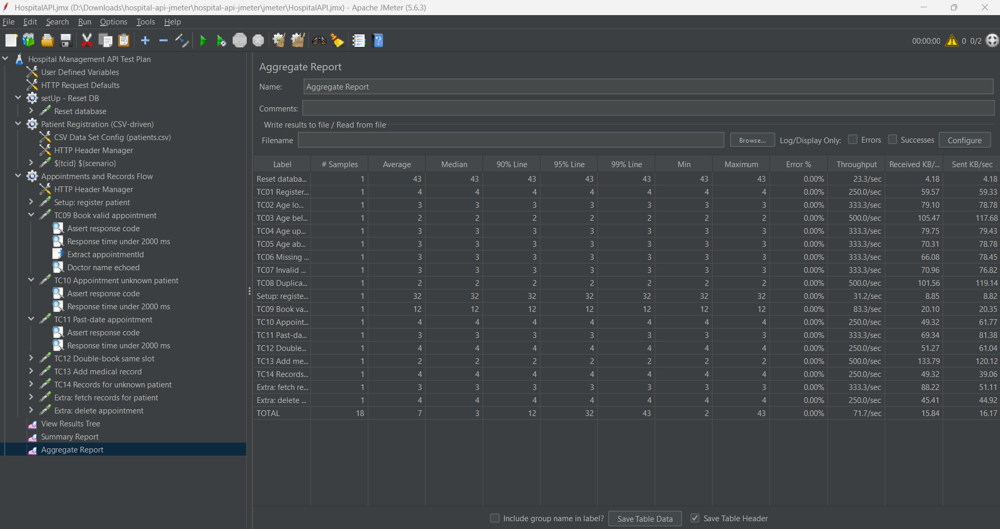
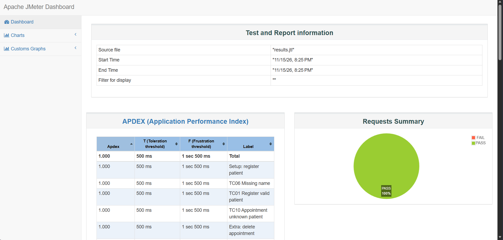
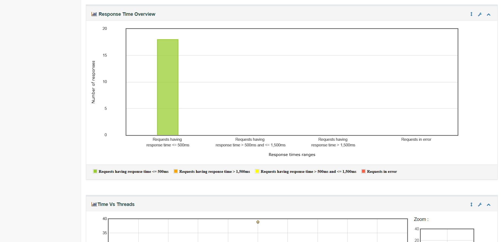
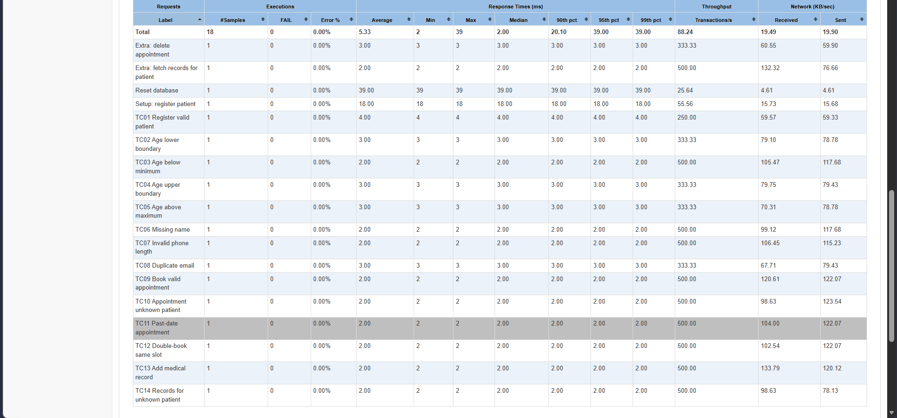

# Hospital Management API Testing with Apache JMeter

**Course:** Software Testing & Quality Assurance (ISE2501), CA3, Option 1: Specialized Tool Exploration & Program Unit / API Testing
**Tool:** Apache JMeter 5.6.3 **SUT:** Hospital Management REST API (Python Flask)
**Scope:** Patient registration, appointments and medical records

| Student | Role | Name / USN / Section |
|---|---|---|
| A | Lead Tool Architect & Framework Specialist (JMeter setup, test plan, execution, reports) | Skandhan M U, 20241ISE0045 |
| B | Lead Test Designer & SUT Engineer (API code, test case design) | Srujan R Vernrkar, 20241ISE001 |

## Repository contents
```
api/app.py                 Flask API under test (SUT)
jmeter/HospitalAPI.jmx     JMeter test plan (11 samplers, assertions, extractors)
jmeter/patients.csv        Data for CSV-driven tests TC01-TC08
jmeter/build_jmx.py        Script that regenerates HospitalAPI.jmx
jmeter/run_checks.py       Python cross-check of the same test matrix
results/                   Execution logs, results.jtl, HTML dashboard (results/report)
docs/screenshots/          Execution screenshots used in the PPT
```

## Prerequisites
- Python 3.9+ (python.org; tick "Add Python to PATH")
- Java 8 or newer (adoptium.net); check with `java -version`
- Apache JMeter 5.6.x: download the Binaries zip from jmeter.apache.org and unzip it
- Python packages: `pip install flask requests`

## Procedure to run the code and use the tool

### Step 1: Start the API (SUT)
Run the two commands one after the other (PowerShell does not accept `&&`):
```
cd api
python app.py
```
Output should include `Running on http://127.0.0.1:5000`. Keep this window open.
Quick check: open http://127.0.0.1:5000/patients/1 in a browser; `{"error":"patient not found"}` means it works.

### Step 2: Run in the JMeter GUI (to view the test plan and live listeners)
1. Run `bin\jmeter.bat` (Windows) or `bin/jmeter.sh` (Mac/Linux) from the JMeter folder.
2. File > Open > `jmeter/HospitalAPI.jmx`.
3. Click the green Start button.
4. Inspect View Results Tree, Summary Report and Aggregate Report.

### Step 3: Run headless and generate the HTML dashboard (used for the report)
Open a **second** terminal (leave the API running), go to the `jmeter` folder and run.
Windows PowerShell:
```
cd jmeter
Remove-Item ..\results\report -Recurse -Force -ErrorAction SilentlyContinue
Remove-Item ..\results\results.jtl -Force -ErrorAction SilentlyContinue
& "<path-to>\apache-jmeter-5.6.3\bin\jmeter.bat" -n -t HospitalAPI.jmx -l ..\results\results.jtl -e -o ..\results\report
start ..\results\report\index.html
```
Mac / Linux:
```
cd jmeter
rm -rf ../results/report ../results/results.jtl
<path-to>/apache-jmeter-5.6.3/bin/jmeter -n -t HospitalAPI.jmx -l ../results/results.jtl -e -o ../results/report
```
Run the commands from the `jmeter` folder, because the output paths are relative to it.
Use `-Jhost=<host> -Jport=<port>` to point JMeter at a different API address.

### Step 4: (Optional) Python cross-check
```
cd jmeter
python run_checks.py
```
Prints a pass/fail table for the same test cases and ends with `Passed 18 | Failed 0`.

### Step 5: List any failed requests
```
Import-Csv ..\results\results.jtl | Where-Object { $_.success -eq 'false' } | Select-Object label,responseCode,failureMessage | Format-List
```

## How the test plan works
- **setUp Thread Group** calls `POST /reset` so every run starts from an empty database (repeatable runs).
- **Patient Registration (CSV-driven)** reads `patients.csv`; a Response Assertion compares the status code to `${expected}`; a JSON Extractor stores the new `id`.
- **Appointments and Records Flow** registers a patient, extracts its id, then runs the appointment and record tests, and also checks a record fetch and an appointment delete.
- Every request also has a **2000 ms Duration Assertion**.
- Techniques: boundary value analysis (age 0 / 120), negative validation, syntax and type checks.

## Test cases
| ID | Scenario | Input | Expected |
|---|---|---|---|
| TC01 | Register valid patient | age=35, valid phone | 201 |
| TC02 | Age lower boundary | age=0 | 201 |
| TC03 | Age below minimum | age=-1 | 400 |
| TC04 | Age upper boundary | age=120 | 201 |
| TC05 | Age above maximum | age=121 | 400 |
| TC06 | Missing name | name="" | 400 |
| TC07 | Invalid phone length | phone=12345 | 400 |
| TC08 | Duplicate email | same email twice | 409 |
| TC09 | Book valid appointment | valid patient, future date | 201 |
| TC10 | Appointment, unknown patient | patientId=9999 | 404 |
| TC11 | Past-date appointment | date=2020-01-01 | 400 |
| TC12 | Double-book same slot | same doctor + time | 409 |
| TC13 | Add medical record | valid patient, diagnosis | 201 |
| TC14 | Records, unknown patient | patientId=9999 | 404 |

## Results (JMeter 5.6.3, non-GUI run)
18 samples, 0 errors (100% pass), average 5 ms, max 39 ms, throughput about 65.7 requests/s.
Screenshots: `docs/screenshots/`. Dashboard: `results/report/index.html`.

## Troubleshooting
- `python` not recognized: reinstall Python with "Add to PATH".
- `No module named flask`: run `pip install flask requests`.
- `Address already in use`: another program uses port 5000; close it or the old API window.
- `Cannot write to ... results\report`: run the command from the `jmeter` folder and delete an existing `results\report` first.
- Many errors in JMeter: confirm the API window is still running, then re-run.

## Screenshots
Test plan: HTTP request with JSON body


View Results Tree (all 18 requests passed)


Summary Report (GUI run)


Aggregate Report (GUI run)


HTML dashboard: overview, requests summary 100% pass


HTML dashboard: response time overview


HTML dashboard: statistics table with percentiles

